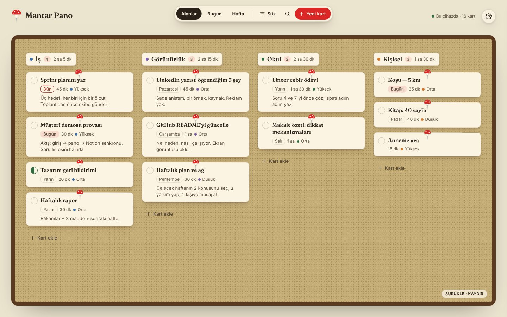
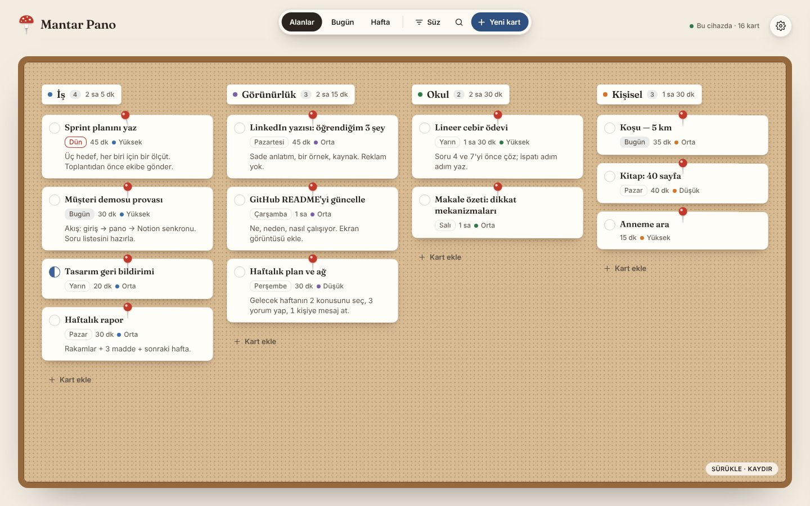
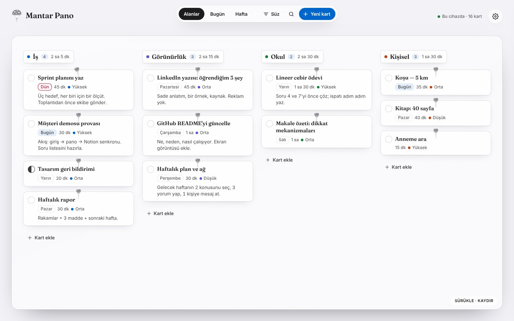
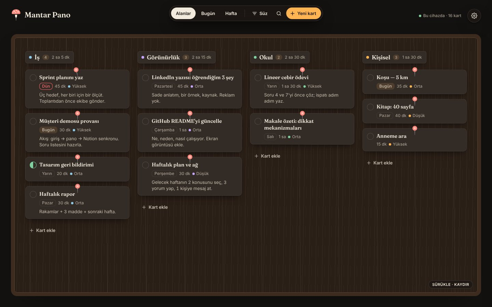
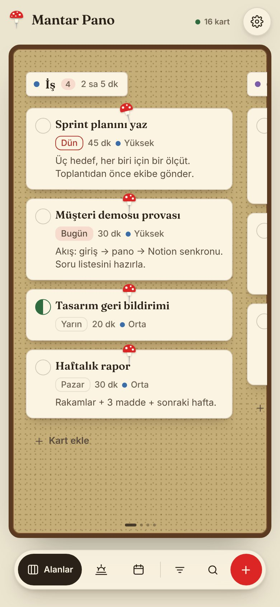
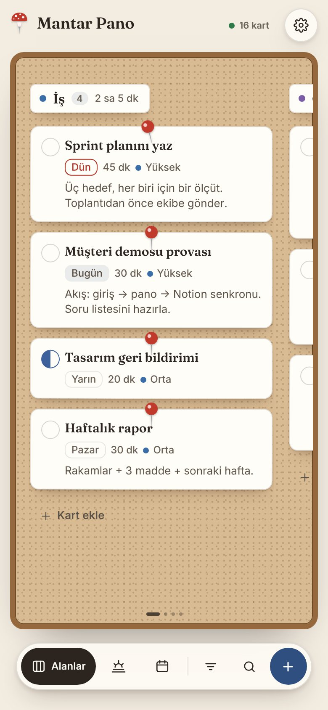
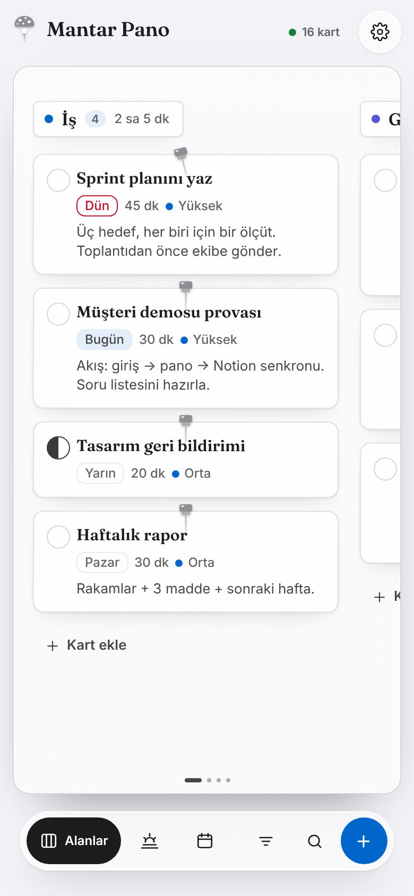
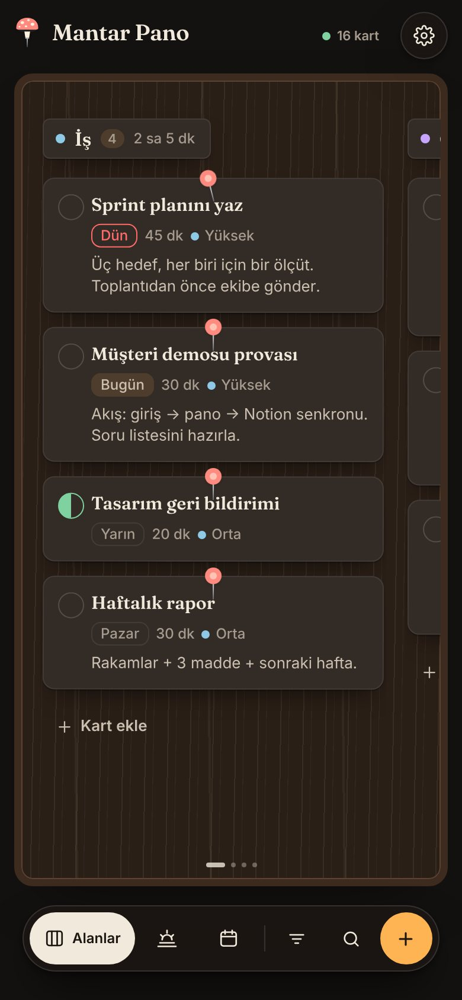

# 🍄 Mantar Pano

**A cork-board task app that syncs live with Notion — with a Retro MSN twist.**
React 19 · Vite 7 · TypeScript · TanStack Query · dnd-kit · Motion · Hono · Web Audio API

[](https://github.com/iamnotanoctopus/mantar-pano/actions/workflows/deploy.yml) [](LICENSE)

Notion'daki bir görev veritabanını, kâğıt kartlar ve raptiyelerle **tek bir mantar panoya** dönüştürür.
v2'de sekme yoktur: pano her şeydir; üstünde yüzen bir **filtre kapsülü** (Alanlar · Bugün · Hafta · Süz · Ara)
ve sağ üstte bir **tema & ayarlar çekmecesi** vardır. Kartlar yay fiziğiyle kalkar, kayar ve raptiyeyle saplanır.
Üç çalışma modu vardır: tamamen tarayıcıda (**local-first**), kendi sunucunla **Notion API** üzerinden, ya da
claude.ai içinde **sunucusuz Notion senkronu**. Dört tema, MSN Messenger tarzı **dürtme** ve ses dosyası
kullanmayan **sentezlenmiş ses efektleri** ile gelir.

<p>
  
  
</p>
<p>
  
  
</p>
<p>
  
  
  
  
</p>

> Canlı demo: **https://iamnotanoctopus.github.io/mantar-pano/** (local-first; kartlar tarayıcında kalır)

---

## In English (TL;DR)

Mantar Pano is a cork-board task app that syncs live with Notion: it turns a Notion task database into paper cards
and pins on a single draggable cork board, with a floating filter capsule (Areas, Today and Week focus, filter, search)
and a theme & settings drawer instead of tabs.
It is built with React 19, Vite 7, TypeScript, TanStack Query, dnd-kit, Motion, Hono and the Web Audio API.
Three data modes share the same UI: a local-first static build (cards stay in your browser, with JSON export/import),
the Notion API through your own Hono proxy, and serverless Notion sync inside claude.ai using the viewer's own Notion connector.
It ships with four themes generated from one design-token file (Amanita, Classic Cork, Cupertino Glass, Midnight Wood),
spring physics for every motion, an MSN Messenger-style nudge, and sound effects synthesized with the Web Audio API
instead of audio files.
Try the live demo at **https://iamnotanoctopus.github.io/mantar-pano/** (local-first; cards stay in your browser).
Design decisions and measurements are in [docs/CASE_STUDY.md](docs/CASE_STUDY.md).

## Özellikler

| Alan | Ne var |
|---|---|
| **Tek pano** | Sürüklenebilir mantar pano; üç odak: **Alanlar** (alan şeritleri), **Bugün** (Gecikenler · Bugün · Yarın), **Hafta** (Pzt … Paz + Tarihsiz, ay ızgarası popover'ı). Odak değişince kartlar yeni şeride yaylanarak kayar, dışarıda kalanlar söner; "N kart odak dışında" notu |
| **İki menü** | **Filtre kapsülü**: odak, Süz (alan ve öncelik çoklu, bitmişleri göster), arama, yeni kart; telefonda altta. **Tema & ayarlar çekmecesi**: tema, pano dokusu, raptiye stili, ses, dürtme, veri, kısayollar |
| **Kart** | Başlık, alan, durum, öncelik, tarih, süre, not; tek tıkla tamamlama; ayrıntı çekmecesi; şerit başına hızlı ekleme; şeride bırakınca alan ya da tarih değişir |
| **Gün etiketi** | "Bugün · Yarın · Cumartesi · 24 Eki · 3 gün gecikti" — Notion'daki formülün istemci tarafı karşılığı |
| **Temalar** | Amanita (varsayılan), Klasik Mantar Pano, Cupertino Glass, Midnight Wood; "Sisteme uy" seçeneğinde açıkta Amanita, koyuda Midnight. Doku (mantar · ahşap · cam · düz) ve raptiye stili temadan bağımsız seçilebilir |
| **Fizik** | Her hareket bir yay (380 / 30 / 0.8): kart tutulunca yükselir ve 1.5° eğilir, bırakılınca raptiye 1.2 → 1.0 sekerek saplanır (520 / 18); pano ataletle kayar, kenarda yaylanır |
| **Retro etkileşim** | MSN tarzı **dürtme** (`D`, ayarlar ya da açılışta gecikmiş kart varsa); Web Audio ile sentezlenen pin / bitti / sil / dürtme sesleri |
| **Veri** | Local-first (localStorage + JSON dışa/içe aktarma), Notion API (Hono proxy), claude.ai artifact (MCP) |
| **UX** | Optimistic güncellemeler, kısayollar (`N` yeni kart, `/` ara, `D` dürt, `1 2 3` odak, `T` takvim, `Esc` kapat), telefonda kapsül başparmak hizasında, PWA manifest, `prefers-reduced-motion` (yaylar anında, titreme yerine parlama) |

## Hızlı başlangıç

```bash
npm install
npm run dev          # http://localhost:5173 — Hono API (8787) ile birlikte, demo verisiyle
```

Statik demo (sunucusuz, local-first):

```bash
npm run build:static && npx vite preview
```

## Üç veri modu

Veri katmanı derleme zamanında `VITE_API_MODE` ile seçilir; arayüz kodu aynıdır (`src/data/index.ts`).

| Mod | Ne zaman | Nasıl |
|---|---|---|
| `local` | Statik yayın, çevrimdışı, demo | `npm run build:static` — kartlar tarayıcıda; Ayarlar → JSON dışa/içe aktar |
| `http` (varsayılan) | Kendi sunucun, gerçek Notion senkronu | `npm run build && npm start` — `.env` içinde `NOTION_TOKEN` (aşağıda) |
| `mcp` | claude.ai içinde, sunucusuz Notion senkronu | `npm run build:artifact` → `artifact/mantar-pano.html`; görüntüleyenin kendi Notion bağlayıcısını kullanır |

### Notion bağlantısı (http modu)

1. <https://www.notion.so/profile/integrations> → **New integration** (Internal; Read / Update / Insert).
2. Secret'ı `.env` içine: `NOTION_TOKEN=...` (`cp .env.example .env`).
3. Notion'da pano sayfası → `···` → **Connections** → entegrasyonu ekle.
4. `NOTION_DATA_SOURCE_ID` ya da `NOTION_DATABASE_ID` ver (`.env.example` açıklıyor).

Beklenen veritabanı şeması: **Görev** (title) · **Alan** (select) · **Durum** (status) · **Öncelik** (select) ·
**Tarih** (date) · **Süre (dk)** (number) · **Not** (text). Seçenek adları Notion'dan okunur; bilinmeyen bir
seçenek Notion'a asla yazılmaz (Notion'un yeni seçenek üretmesi engellenir).

## Mimari

```
design/         tokens.json — tasarım sisteminin tek kaynağı (renk, gölge, yapı, ölçü, yazı, fizik)
src/
  app/          App.tsx — odak, süzgeç, hafta durumu, kısayollar, dürtme/ses tetikleyicileri
  board/        Board.tsx (pan + atalet, layout animasyonları, dnd-kit) · layouts.ts (byArea, byToday, byWeek, applyFilters)
  components/   TopBar, Capsule, FilterMenu, SettingsDrawer, DatePopover, TaskCard, Pin, Logo, TaskDrawer, QuickAdd, Toast, Gate
  hooks/        useTasks (TanStack Query + optimistic), useSound, useNudge, useDismiss, useMediaQuery
  data/         http.ts · local.ts · mcpNotion.ts · index.ts (mod seçimi) · demoSeed.ts
  lib/          dates (Gün etiketi), views (Notion görünüm kuralları), themes, brand (logo/raptiye geometrisi), physics (yaylar), sounds
  state/        prefs + prefsModel (tema, doku, raptiye, odak, süzgeç — localStorage, v1 → v2 göçü)
  styles/       tokens.css (eşlemeler) · base.css · nudge.css · themes/*.css (tokens.json'dan üretilir)
  test/         prefs.test.ts · layouts.test.ts
server/         Hono API: NotionRepo (Notion API 2025-09-03), DemoRepo, doğrulama, isteğe bağlı şifre
shared/         Ortak tipler, varsayılan şema, örnek kartlar
scripts/        build-static · build-artifact · build-themes · build-icons · build-screenshots
```

Tasarım kararları ve ölçümler için **[docs/CASE_STUDY.md](docs/CASE_STUDY.md)**.

### Temalar nasıl çalışır

`design/tokens.json` tek kaynaktır. `npm run build:themes` her tema için bir `[data-theme="…"]` bloğu üretir
(`src/styles/themes/*.css`); token adı doğrudan CSS değişkenidir (`kart-yuzey` → `--kart-yuzey`). Bileşenler temayı
bilmez, yalnızca token okur; v1'den kalan adlar `tokens.css`'te v2 token'larına eşlenir (`--card-bg: var(--kart-yuzey)`).
Kök öğede üç öznitelik vardır: `data-theme` (dört tema), `data-texture` (mantar · ahşap · cam · düz) ve `data-pin`
(amanita · classic · glass · midnight). Tema önizlemeleri `[data-theme-scope]` ile o temanın token'larını tek bir öğeye uygular.

### Fizik

Yay değerleri `src/lib/physics.ts`'te `tokens.json`'ın `fizik` ailesinden okunur. Motion ile: varsayılan yay
`stiffness 380 · damping 30 · mass 0.8`, raptiye saplanması `520 · 18`. Masaüstünde pano boş yüzeyden sürüklenerek
kaydırılır (inertia power 0.8, timeConstant ~350 ms, kenarlarda direnç); telefonda şeritler yatay `scroll-snap` ile kayar.
dnd-kit kart sürüklemesi için kalır (MouseSensor 6 px, TouchSensor 180 ms). Hareket azaltma açıksa yaylar anında çözülür.

### Dürtme ve sesler

- `useNudge` — `.app` sarmalayıcısını `left/top` ile titretir (transform kullanılmaz; sabit konumlu çekmece bağlam
  kutusunu kaybetmez), telefonda alta sabitlenen kapsül yuvasını da. `prefers-reduced-motion` açıksa titreme yerine
  kısa bir çerçeve parlaması.
- `lib/sounds.ts` — tek `AudioContext`, ilk tıklamada açılır; her ses birkaç osilatör + kazanç zarfı, bittiğinde
  düğümler kopar. MSN dürtmesi: iki kare dalga (vuru), 26 Hz vibrato, 18 Hz tremolo, alçak geçiren süzgeç.

## Komutlar

```bash
npm run dev             # istemci + API (hot reload)
npm run build           # http modu (dist/) — npm start ile servis edilir
npm run build:static    # local-first statik derleme (BASE_PATH=/repo/ ile alt yol)
npm run build:artifact  # claude.ai artifact (tek dosya, mcp modu; Google Fonts'tan yalnızca Fraunces)
npm run build:themes    # design/tokens.json → src/styles/themes/*.css
npm run build:icons     # Amanita raptiye logosu → public/pin.svg, pin-180.png, pin-512.png (Playwright)
npm run build:screenshots  # build:static sonrası → docs/screenshots/*.jpg (4 tema × masaüstü/telefon)
npm test                # Notion eşleme, tercih göçü ve pano odakları testleri
npm run typecheck
```

## Yayın

`main` dalına her push'ta GitHub Actions statik derlemeyi alıp **GitHub Pages**'e yayınlar
(`.github/workflows/deploy.yml`). İlk yayından önce depoda Settings → Pages → Source: **GitHub Actions** seçilmelidir
(Actions tokenı Pages sitesini kendisi oluşturamaz).
Netlify/Vercel için: build komutu `npm run build:static`, çıktı `dist`.

## Yol haritası

- Masaüstü (Tauri) ve mobil (Capacitor) paketleme — aynı `dist/`, `VITE_API_BASE` ile uzak sunucu
- Tam çevrimdışı yazma kuyruğu + Notion ile çift yönlü birleştirme
- Kartlar arası manuel sıralama, tekrarlayan kartlar

## Lisans

MIT — bkz. [LICENSE](LICENSE).
