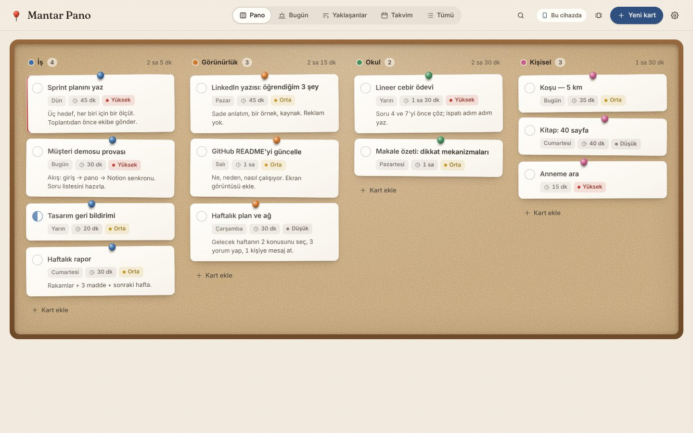
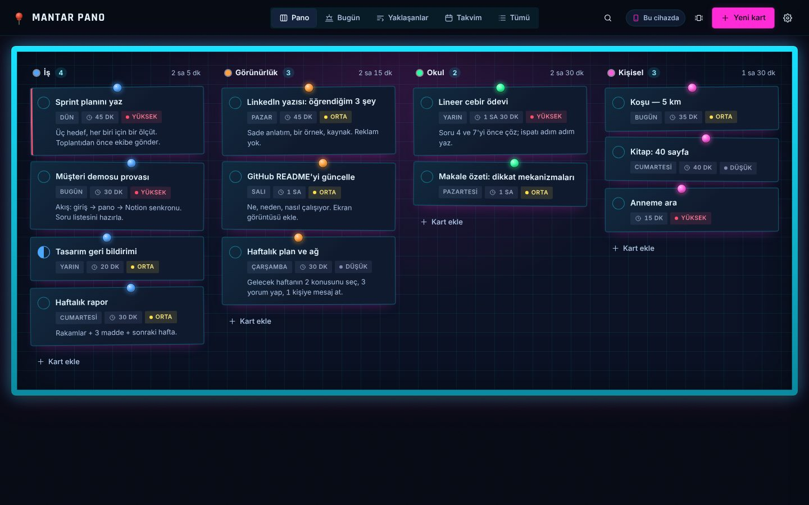
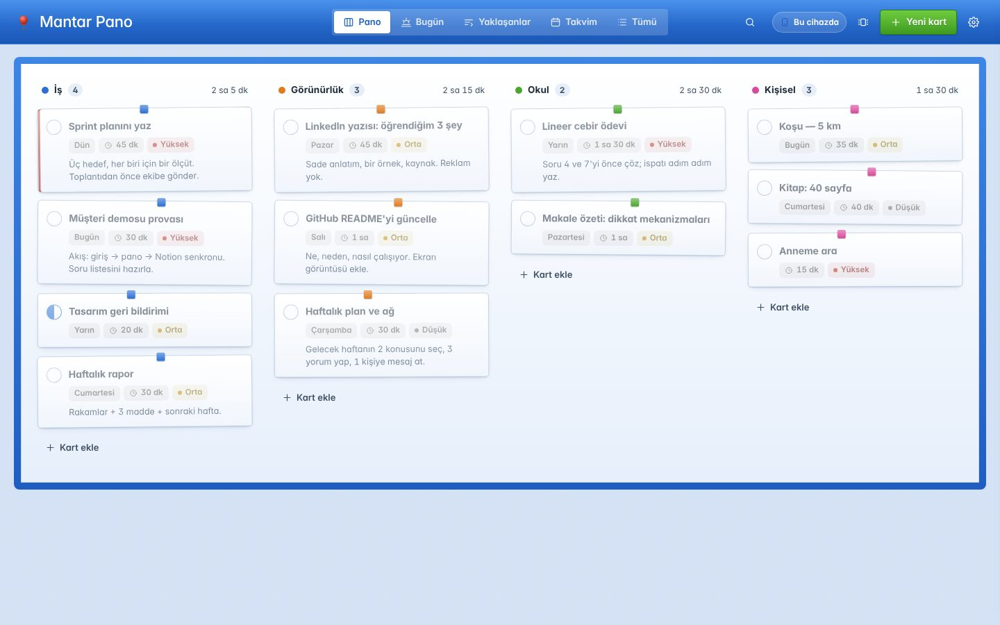
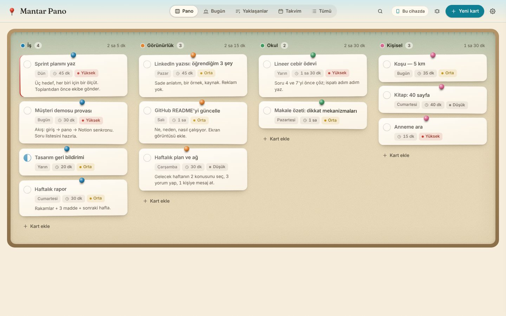

# 📌 Mantar Pano

**A cork-board task app that syncs live with Notion — with a Retro MSN twist.**
React 19 · Vite 7 · TypeScript · TanStack Query · dnd-kit · Hono · Web Audio API

Notion'daki bir görev veritabanını, kâğıt kartlar ve iğnelerle bir **mantar panoya** dönüştürür.
Üç çalışma modu vardır: tamamen tarayıcıda (**local-first**), kendi sunucunla **Notion API**
üzerinden, ya da claude.ai içinde **sunucusuz Notion senkronu**. Dört görünüm teması, MSN
Messenger tarzı **dürtme** ve ses dosyası kullanmayan **sentezlenmiş ses efektleri** ile gelir.

<p>
  
  
</p>
<p>
  
  
</p>

> Canlı demo: **https://iamnotanoctopus.github.io/mantar-pano/** (local-first; kartlar tarayıcında kalır)

---

## Özellikler

| Alan | Ne var |
|---|---|
| **Görünümler** | Pano (alanlara göre sütunlar, sürükle-bırak), Bugün (gecikenler + sıradakiler), Yaklaşanlar (haftalara gruplu), Takvim, Tümü (filtreli) |
| **Kart** | Başlık, alan, durum, öncelik, tarih, süre, not; tek tıkla tamamlama; otomatik kaydeden ayrıntı çekmecesi; hızlı ekleme |
| **Gün etiketi** | "Bugün · Yarın · Cumartesi · 24 Eki · 3 gün gecikti" — Notion'daki formülün istemci tarafı karşılığı |
| **Temalar** | Mantar (varsayılan), Retro MSN, Kumsal, Cyberpunk — her biri açık/koyu, sistem temasına uyar |
| **Retro etkileşim** | MSN tarzı **dürtme** (`D` tuşu, buton, ya da açılışta gecikmiş kart varsa); Web Audio ile sentezlenen pin / bitti / sil / dürtme sesleri |
| **Veri** | Local-first (localStorage + JSON dışa/içe aktarma), Notion API (Hono proxy), claude.ai artifact (MCP) |
| **UX** | Optimistic güncellemeler ve geri alma, arama, klavye kısayolları (`N` yeni, `/` ara, `D` dürt, `1–5` görünüm), mobil düzen, PWA manifest, `prefers-reduced-motion` desteği |

## Hızlı başlangıç

```bash
npm install
npm run dev          # http://localhost:5173 — Hono API (8787) ile birlikte, demo verisiyle
```

Statik demo (sunucusuz, local-first):

```bash
npm run build:static && npx vite preview
```

## Üç veri modu

Veri katmanı derleme zamanında `VITE_API_MODE` ile seçilir; arayüz kodu aynıdır (`src/data/index.ts`).

| Mod | Ne zaman | Nasıl |
|---|---|---|
| `local` | Statik yayın, çevrimdışı, demo | `npm run build:static` — kartlar tarayıcıda; Ayarlar → JSON dışa/içe aktar |
| `http` (varsayılan) | Kendi sunucun, gerçek Notion senkronu | `npm run build && npm start` — `.env` içinde `NOTION_TOKEN` (aşağıda) |
| `mcp` | claude.ai içinde, sunucusuz Notion senkronu | `npm run build:artifact` → `artifact/mantar-pano.html`; görüntüleyenin kendi Notion bağlayıcısını kullanır |

### Notion bağlantısı (http modu)

1. <https://www.notion.so/profile/integrations> → **New integration** (Internal; Read / Update / Insert).
2. Secret'ı `.env` içine: `NOTION_TOKEN=...` (`cp .env.example .env`).
3. Notion'da pano sayfası → `···` → **Connections** → entegrasyonu ekle.
4. `NOTION_DATA_SOURCE_ID` ya da `NOTION_DATABASE_ID` ver (`.env.example` açıklıyor).

Beklenen veritabanı şeması: **Görev** (title) · **Alan** (select) · **Durum** (status) · **Öncelik** (select) ·
**Tarih** (date) · **Süre (dk)** (number) · **Not** (text). Seçenek adları Notion'dan okunur; bilinmeyen bir
seçenek Notion'a asla yazılmaz (Notion'un yeni seçenek üretmesi engellenir).

## Mimari

```
src/
  app/          App.tsx — görünüm seçimi, kısayollar, dürtme/ses tetikleyicileri
  components/   Header, TaskCard, TaskDrawer, QuickAdd, Toast, Gate, icons
  views/        BoardView (dnd-kit), TodayView, UpcomingView, CalendarView, AllView
  hooks/        useTasks (TanStack Query + optimistic), useSound, useNudge
  data/         http.ts · local.ts · mcpNotion.ts · index.ts (mod seçimi) · demoSeed.ts
  lib/          dates (Gün etiketi), views (Notion görünüm kuralları), sounds (Web Audio), skins
  state/        prefs (tema, skin, ses, görünüm — localStorage)
  styles/       tokens.css (tasarım tokenları) · base.css · nudge.css · themes/*.css (üretilir)
server/         Hono API: NotionRepo (Notion API 2025-09-03), DemoRepo, doğrulama, isteğe bağlı şifre
shared/         Ortak tipler, varsayılan şema, örnek kartlar
scripts/        build-static · build-artifact · build-themes (scripts/themes.mjs → CSS)
```

Tasarım kararları ve ölçümler için **[docs/CASE_STUDY.md](docs/CASE_STUDY.md)**.

### Temalar nasıl çalışır

Tüm renkler `:root` üzerinde token olarak tanımlıdır. Koyu tema iki yerde yazılır (sistem tercihi ve açık seçim),
görünüm temaları (`data-skin`) yalnızca tokenları ezer; bileşenler tema bilmez. `scripts/themes.mjs` tek kaynaktır,
`npm run build:themes` CSS dosyalarını üretir.

### Dürtme ve sesler

- `useNudge` — `.app` sarmalayıcısını `left/top` ile titretir (transform kullanılmaz; sabit konumlu alt menü ve
  çekmece bağlam kutusunu kaybetmez). `prefers-reduced-motion` açıksa titreme yerine kısa bir çerçeve parlaması.
- `lib/sounds.ts` — tek `AudioContext`, ilk tıklamada açılır; her ses birkaç osilatör + kazanç zarfı, bittiğinde
  düğümler kopar. MSN dürtmesi: iki kare dalga (vuru), 26 Hz vibrato, 18 Hz tremolo, alçak geçiren süzgeç.

## Komutlar

```bash
npm run dev             # istemci + API (hot reload)
npm run build           # http modu (dist/) — npm start ile servis edilir
npm run build:static    # local-first statik derleme (BASE_PATH=/repo/ ile alt yol)
npm run build:artifact  # claude.ai artifact (tek dosya, mcp modu)
npm run build:themes    # scripts/themes.mjs → src/styles/themes/*.css
npm test                # Notion eşleme testleri (sahte fetch)
npm run typecheck
```

## Yayın

`main` dalına her push'ta GitHub Actions statik derlemeyi alıp **GitHub Pages**'e yayınlar
(`.github/workflows/deploy.yml`). İlk çalıştırmada Pages'i kendisi etkinleştirir (`configure-pages`
`enablement: true`); el ile ayar gerekirse Settings → Pages → Source: **GitHub Actions**.
Netlify/Vercel için: build komutu `npm run build:static`, çıktı `dist`.

## Yol haritası

- Masaüstü (Tauri) ve mobil (Capacitor) paketleme — aynı `dist/`, `VITE_API_BASE` ile uzak sunucu
- Tam çevrimdışı yazma kuyruğu + Notion ile çift yönlü birleştirme
- Kartlar arası manuel sıralama, tekrarlayan kartlar

## Lisans

MIT — bkz. [LICENSE](LICENSE).
